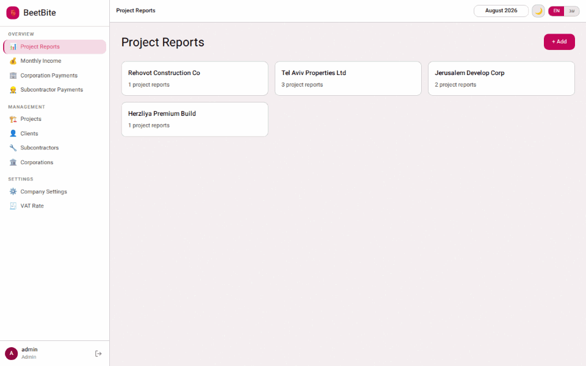
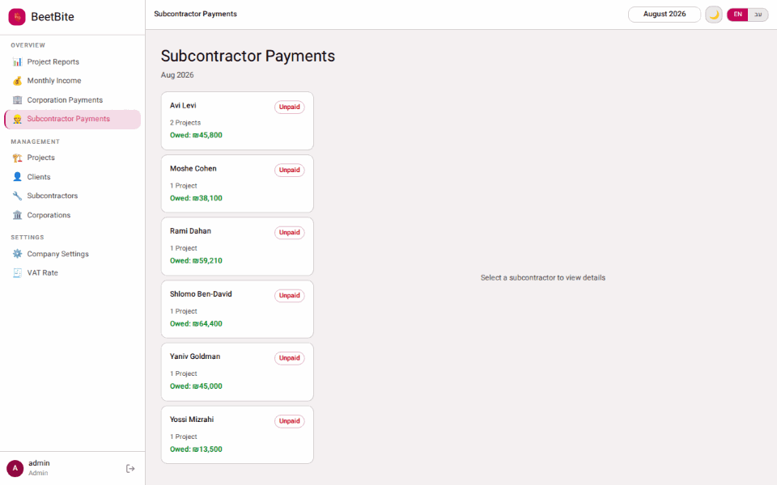
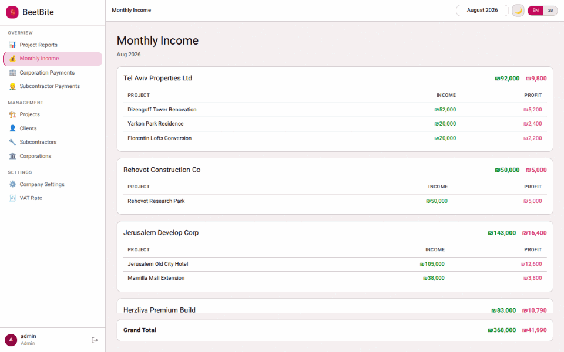
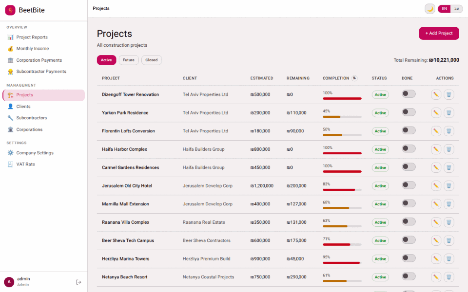
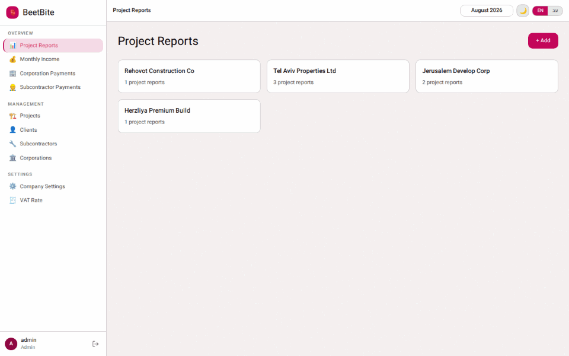
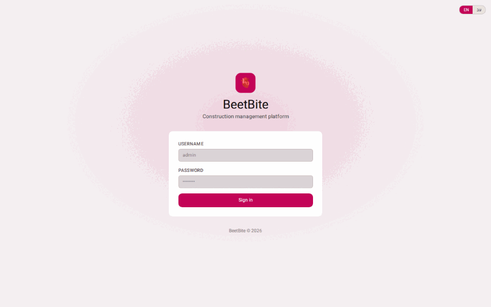
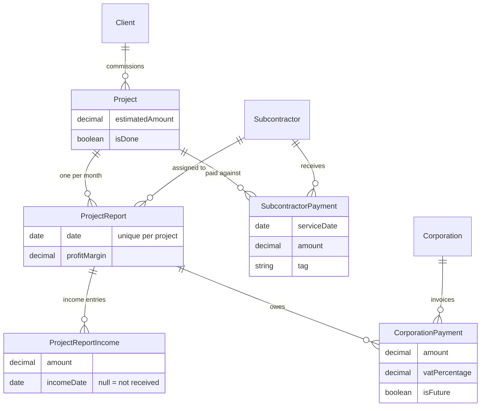
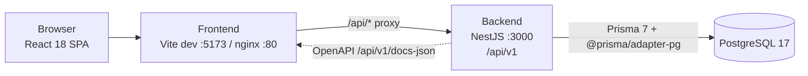

<div align="center">

# 🫀 BeetBite

**Back-office platform for construction contractors.**

Track client projects, monthly income, subcontractor payouts and corporation invoices — every financial figure derived from one monthly report per project, never entered twice.

[](https://github.com/alonshuld/BeetBite/actions/workflows/ci.yml)
[](https://github.com/alonshuld/BeetBite/actions/workflows/e2e.yml)
[](https://github.com/alonshuld/BeetBite/actions/workflows/cd.yml)

NestJS 11 · React 18 · PostgreSQL 17 · Prisma 7 · Playwright · Docker



</div>

---

## Table of contents

- [What it does](#what-it-does)
- [Demo](#demo)
- [How the money works](#how-the-money-works)
- [Architecture](#architecture)
- [Quick start](#quick-start)
- [Configuration](#configuration)
- [Commands](#commands)
- [API](#api)
- [Testing](#testing)
- [CI/CD](#cicd)
- [Project structure](#project-structure)
- [Security notes](#security-notes)

---

## What it does

BeetBite is a single-tenant back office: one deployment serves one contractor company.

Clients commission construction projects and agree on an estimated total up front. They pay the contractor monthly as work progresses. The contractor keeps a profit margin, pays specialist firms (corporations) their fixed monthly amounts, and passes the remainder to the subcontractor working that project.

The operator enters clients, projects, corporations and subcontractors once, then files **one report per project per month**. Everything else — profits, payouts, income totals, payment progress, per-client aggregates — is computed from those reports at read time.

| | |
| --- | --- |
| 📊 **Monthly project reports** | Multiple income entries per month, pending vs. received, per-report profit margin, attached corporation payments |
| 💰 **Monthly income** | Income and profit rolled up per client and per project, with a grand total for the month |
| 👷 **Subcontractor payouts** | Amount owed computed from reports; partial payments with a transactional overpayment guard and free-text tags |
| 🏢 **Corporation payments** | Fixed amounts per project report, optional VAT %, and a "future" flag for work not yet invoiced |
| 🏗️ **Project portfolio** | Active / future / closed filters, payment progress against the estimated amount, remaining balance |
| 🧾 **VAT rates** | Month-effective VAT table, resolved per payment date |
| 📄 **PDF export** | Subcontractor account-approval document rendered server-side with Puppeteer |
| 🌐 **English + Hebrew** | Full RTL layout switch, light and dark themes, month-scoped navigation throughout |

---

## Demo

> All recordings use the seeded demo dataset (`SEED_MOCK_DATA=true`): 30 clients, 35 projects, and reports going back two years.

### Monthly project reports

Pick a client for the month and every project card shows its income entries (pending or received), the derived profit, each corporation's cut, and what is left for the subcontractor. The profit simulator at the bottom re-runs the whole month against a different margin without touching stored data.


### Subcontractor payments

Amount owed is derived from the month's reports. Partial payments are recorded against a specific project, tagged, and rejected server-side if they would exceed what is owed — the check and the write happen inside one transaction.



### Monthly income and month-scoped navigation

The month picker in the header scopes every overview screen at once — reports, income, corporation payments and subcontractor payments all follow it.



### Project portfolio



### Hebrew (RTL) and dark mode



### Sign in

JWT issued by the backend, stored in `localStorage`, sent as a bearer token on every request.



---

## How the money works

Financial figures are **never stored**. They are computed on read from the report and its children:

```
profit                = totalIncome × profitMargin / 100
subcontractorPayment  = totalIncome − profit − Σ corporationPayments
project.totalPaid     = Σ income entries where incomeDate IS NOT NULL
completionPercent     = totalPaid / project.estimatedAmount × 100
```

A subcontractor payment is the one amount the caller supplies. Before it is written, the service recomputes what is owed for that subcontractor **on that project for that service month** and rejects the payment if the existing payments plus the new one would exceed it. The guard and the insert share a single `$transaction`, so two concurrent requests cannot both pass the check.

When a report omits `subcontractorId` or `profitMargin`, the service inherits them from the previous month's report for the same project.

### Data model



`CompanySettings` is a singleton holding the contractor's own profile (name, company number, contact details, logo and signature as base64 data URLs). It backs the skippable onboarding screen and the PDF export. `VatRate` stores month-effective VAT percentages. `User` holds the single admin account.

---

## Architecture



pnpm workspace with three apps:

| App | Path | Stack |
| --- | --- | --- |
| `backend` | `apps/backend/` | NestJS 11, Prisma 7, PostgreSQL, Passport JWT, Swagger, Puppeteer (PDF) |
| `frontend` | `apps/frontend/` | Vite, React 18, TypeScript strict, Redux Toolkit + RTK Query, Tailwind CSS v3, React Router v7 |
| `e2e` | `apps/e2e/` | Playwright, testcontainers-driven full-stack bootstrap |

Notable choices:

- **Derived-at-read financials.** No denormalized totals to drift out of sync; the report and its children are the only source of truth.
- **Typed API contract.** The frontend generates `schema.d.ts` from the backend's OpenAPI document (`pnpm --filter frontend codegen`), so DTO changes surface as TypeScript errors instead of runtime surprises.
- **Global auth by default.** `JwtAuthGuard` is registered as an `APP_GUARD`; routes are protected unless explicitly marked `@Public()`.
- **Domain errors, not HTTP exceptions, in services.** `EntityNotFoundError` / `EntityAlreadyExistsError` subclasses are mapped to status codes by a single global exception filter.
- **Mappers own the boundary.** Prisma `Decimal → number` and `Date → ISO string` conversion happens in one place per module, with explicit field picks so internal FKs never leak into responses.

---

## Quick start

### Docker (full stack)

```bash
cp .env.example .env
# edit .env — JWT_SECRET (openssl rand -base64 48) and ADMIN_PASSWORD are required
docker compose up
```

| Service | URL |
| --- | --- |
| Frontend | http://localhost |
| Backend | http://localhost:3000/api/v1 |
| Swagger UI | http://localhost:3000/api/v1/docs *(non-production only)* |
| PostgreSQL | `localhost:5432` |

`JWT_SECRET` and `ADMIN_PASSWORD` have no defaults on purpose — compose aborts if either is missing rather than shipping a signing key and an admin login that every reader of this repo would already know. The backend container runs `prisma migrate deploy` and the seed on every start; the seed creates the admin only if it does not exist and **never** overwrites an existing password, so a restart cannot undo a rotated credential.

### Local development

```bash
pnpm install
pnpm infra:up          # docker compose up db backend -d
pnpm --filter frontend dev
```

Or run everything from source against a database only:

```bash
docker compose up db -d
cd apps/backend && pnpm prisma migrate deploy && pnpm start:dev
cd apps/frontend && pnpm dev            # :5173, proxies /api → :3000
```

### Demo data

```bash
SEED_MOCK_DATA=true pnpm --filter backend exec prisma db seed
```

> ⚠️ **Destructive.** The mock seed truncates every business table before inserting fixtures. Never run it against a database holding real records.

---

## Configuration

Backend variables, read from `.env` / `.env.local` (the latter wins):

| Variable | Required | Default | Description |
| --- | :---: | --- | --- |
| `DATABASE_URL` | ✅ | — | PostgreSQL connection string |
| `JWT_SECRET` | ✅ | — | Signs every JWT. In production the app refuses to start if it is a known placeholder or under 32 characters |
| `ADMIN_PASSWORD` | ✅¹ | — | Bootstraps the admin account on first start; ignored once the user exists |
| `ADMIN_USERNAME` | | `admin` | Seed admin username |
| `PORT` | | `3000` | HTTP port |
| `NODE_ENV` | | `development` | `development` / `production` |
| `JWT_EXPIRES_IN` | | `24h` | Token TTL |
| `ALLOWED_ORIGINS` | | — | Comma-separated CORS origins (production only) |
| `SEED_MOCK_DATA` | | `false` | `true` loads demo data — **truncates every business table first** |

¹ Required the first time the admin user is created. Compose-level database variables (`DB_USER`, `DB_PASSWORD`, `DB_NAME`) are documented in `.env.example`.

There is no in-app password change: treat `ADMIN_PASSWORD` as the account credential and rotate it by updating the hash directly.

---

## Commands

Run from the repo root — these fan out across the workspace:

```bash
pnpm dev            # backend + frontend dev servers
pnpm build          # build all apps
pnpm test           # backend Jest + frontend Vitest
pnpm lint           # ESLint + tsc (auto-fix)
pnpm lint:check     # ESLint + tsc, no fix (what CI and the pre-commit hook run)
pnpm format         # Prettier write
pnpm test:e2e       # Playwright suite (requires Docker)
pnpm infra:up       # docker compose up db backend -d
pnpm infra:down     # stop them
```

Per app:

```bash
pnpm --filter backend start:dev            # Nest watch mode
pnpm --filter backend test:cov             # Jest coverage
pnpm --filter backend exec prisma migrate dev
pnpm --filter backend seed:demo:he         # Hebrew demo dataset (destructive)
pnpm --filter frontend codegen             # regenerate API types (backend must be running)
pnpm --filter frontend vitest run src/pages/ReportsPage.test.tsx
pnpm --filter e2e exec playwright test --ui
```

A Husky pre-commit hook runs `pnpm format:check` then `pnpm lint:check`.

---

## API

All routes are prefixed `/api/v1` and require `Authorization: Bearer <token>` except `POST /auth/login`. Interactive Swagger UI lives at `/api/v1/docs` outside production.

| Area | Endpoints |
| --- | --- |
| Auth | `POST /auth/login` |
| Clients | `POST/GET /clients` · `GET/PUT/DELETE /clients/:id` |
| Projects | `POST/GET /projects` · `GET/PUT/DELETE /projects/:id` — `GET` accepts `active`, `future`, `closed`, `clientId` |
| Project reports | `POST/GET /projects/reports` · `GET/PUT/DELETE /projects/reports/:id` · `GET /projects/:id/reports/previous` |
| Income entries | `POST /projects/reports/:reportId/income-entries` · `PUT/DELETE /projects/reports/income-entries/:id` |
| Income | `GET /income?month=` — the month's income grouped by client and project |
| Corporations | `POST/GET /corporations` · `GET/PUT/DELETE /corporations/:id` |
| Corporation payments | `POST/GET /corporations/payments` · `GET /corporations/:corporationId/payments` · `PUT/DELETE /corporations/payments/:id` |
| Subcontractors | `POST/GET /subcontractors` · `GET/PUT/DELETE /subcontractors/:id` |
| Subcontractor payments | `POST/GET /subcontractors/payments` · `GET /subcontractors/:subcontractorId/payments` · `GET /subcontractor-payments/by-client?month=` · `GET /subcontractor-payments/tags` · `PUT/DELETE /subcontractors/payments/:id` |
| Company settings | `GET/PUT /company-settings` (singleton) |
| VAT rates | `GET/PUT /vat-rates` · `GET /vat-rates/resolve` |
| PDF export | `POST /projects/reports/export-pdf` |

Validation is global and strict: unknown properties are rejected with 400 (`whitelist` + `forbidNonWhitelisted`), and error messages are suppressed in production.

---

## Testing

| Suite | Count | What it covers |
| --- | --- | --- |
| Backend unit (Jest) | 350 tests / 30 suites | Controllers and services with `PrismaService` fully mocked |
| Backend integration (Jest) | `pnpm --filter backend test:e2e` | Services against a real PostgreSQL via testcontainers |
| Frontend unit (Vitest) | 305 tests / 38 files | Components, pages and hooks in jsdom |
| End-to-end (Playwright) | 60 tests / 9 suites | Auth, clients, projects, project reports, corporations, corporation payments, subcontractors, subcontractor payments, income |

The Playwright suite bootstraps the entire stack itself — `global-setup.ts` starts a PostgreSQL testcontainer, applies migrations, seeds an admin, builds and starts the backend on `:3001`, starts the frontend on `:5174`, and saves an authenticated storage state. Each spec truncates the database in FK-safe order after every test.

```bash
pnpm test:e2e                     # headless
E2E_VERBOSE=1 pnpm test:e2e       # stream backend/frontend logs
```

---

## CI/CD

| Workflow | Trigger | Jobs |
| --- | --- | --- |
| `ci.yml` | push / PR on `main`, `dev`; callable | Format check, ESLint + `tsc`, backend Jest, frontend Vitest, full build |
| `e2e.yml` | push / PR on `main`, `dev` | Playwright suite; uploads the HTML report on failure |
| `cd.yml` | push to `main`, manual | Re-runs CI, builds both images, then publishes to GHCR |

CD is deliberately two-phase: both images must build before either is pushed, so `latest` never advances for one app while the other is broken. Published images:

```
ghcr.io/alonshuld/beetbite-backend:latest
ghcr.io/alonshuld/beetbite-frontend:latest
```

Each is also tagged with the commit SHA and the branch name.

---

## Project structure

```
BeetBite/
├── apps/
│   ├── backend/            # NestJS API
│   │   ├── prisma/         # schema, migrations, seed
│   │   └── src/
│   │       ├── auth/ users/                     # JWT + Passport, global guard
│   │       ├── clients/ projects/ corporations/ subcontractors/
│   │       ├── project-reports/ corporation-payments/ subcontractor-payments/
│   │       ├── income/ incomes/ vat-rates/ company-settings/
│   │       ├── pdf-export/                      # Puppeteer templates
│   │       ├── common/                          # error hierarchy, filters, constants
│   │       └── generated/                       # Prisma client (git-ignored)
│   ├── frontend/           # React SPA
│   │   └── src/
│   │       ├── api/        # RTK Query slices + generated OpenAPI types
│   │       ├── components/ # atoms / molecules / organisms
│   │       ├── contexts/   # language (en/he), theme, toasts
│   │       └── pages/      # one lazy-loaded file per route
│   └── e2e/                # Playwright specs + testcontainers bootstrap
├── docs/media/             # demo recordings used by this README
├── docker-compose.yml
└── .github/workflows/      # ci · e2e · cd
```

---

## Security notes

- Passwords are hashed with bcrypt at 12 rounds; only the hash is ever stored.
- `JwtAuthGuard` is global — a new controller is protected unless it opts out with `@Public()`.
- `JWT_SECRET` and `ADMIN_PASSWORD` are required with no fallback; in production the backend also rejects short or placeholder secrets at startup.
- The seed never overwrites an existing admin password, so container restarts cannot reset a rotated credential.
- `SEED_MOCK_DATA` is opt-in and destructive; keep it unset everywhere but throwaway environments.
- CORS origins are explicit in production via `ALLOWED_ORIGINS`.
- Validation rejects unknown request properties, and validation error details are hidden in production responses.

---

<div align="center">
<sub>Built with NestJS, React and Prisma.</sub>
</div>
